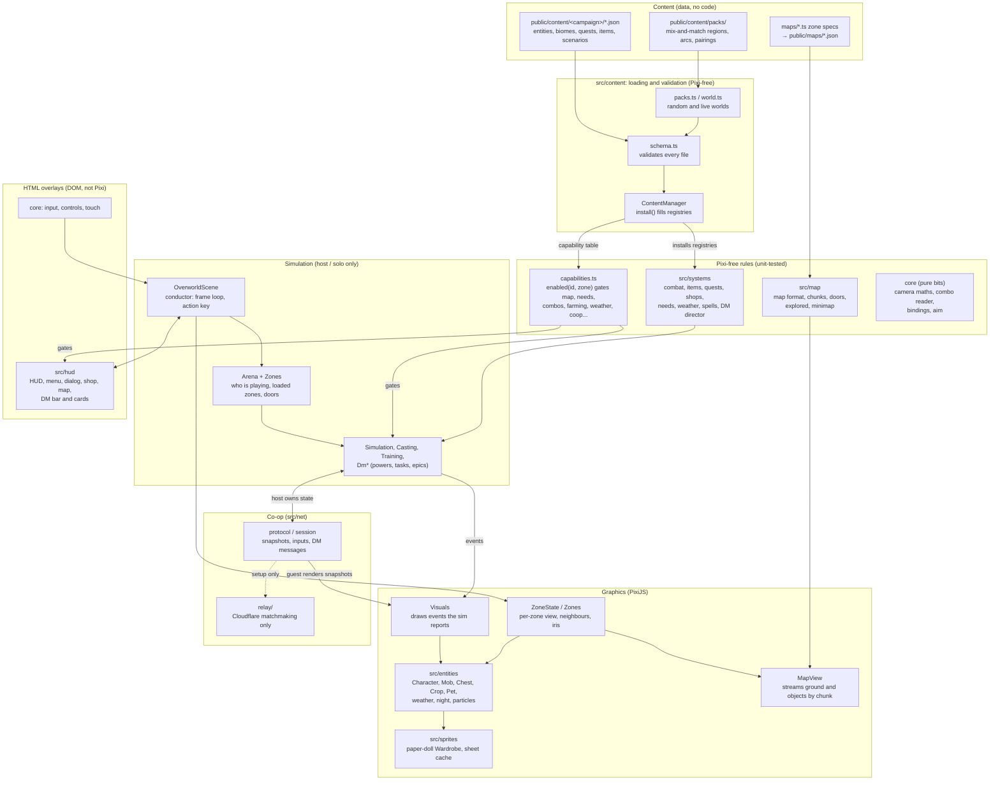

# Me RPG

A small top-down RPG built with [PixiJS](https://pixijs.com) v8, Vite and TypeScript, deployed to GitHub Pages.

## Develop

```bash
npm install
npm run dev
```

Controls: WASD / arrow keys to move, Space / J / Enter / E to attack (or talk when next to the NPC),
Esc / I / Tab for the menu. With a wand or tome from the wizard's shop in hand, tap a string of five or six
directions (for example W D W A D) to cast a spell for MP; it is stronger than the plain attack. Every wand and tome has its own spells.
On phones and tablets an on-screen D-pad (drag your thumb, 8-way) plus **A** (attack/talk)
and **☰** (menu) buttons appear; flick the D-pad (up, up, left, right) to cast a combo.

Enemies (shades, goblins, wolfkin, skeletons, zombies, orcs, trolls, raiders, frostbound) wander near
their spawn, chase you on sight and attack after a yellow-flashing swing windup. They respawn a few
seconds after dying; if you fall, you wake at the spawn point with full HP/MP and keep your XP.

Checks (all run in CI on every pull request):

```bash
npm run verify    # lint, format check, typecheck, unit tests, map and sprite checks
npm run test:e2e  # browser smoke tests against the production build (needs Chromium)
npm run build     # typecheck, map and sprite checks, production build
```

## Architecture: who owns what

Content is data, the engine reads it through registries, capabilities gate optional systems, and Pixi code
is kept apart from Pixi-free rules so the rules are unit-tested without a browser. Arrows mean "depends on / reads".



Boundaries to keep:

- **Engine code never names a content id** (no item, biome or mob id in `src/`); ask a property, a role or the registry.
- **Optional systems are capabilities**, gated at one choke point with `enabled(id, zone)`.
- **Rules live in Pixi-free modules** (`systems`, `map`, `content`); only `entities`, `sprites`, `MapView`, `Visuals` and the zone drawing touch PixiJS.
- **The host owns all simulation.** A guest sends inputs and requests and draws what the host sends; the relay only sets up the connection.
- **Zone loading and drawing** (`Zones`, `ZoneState`, `MapView`) is separate from the rules that run inside a zone (`Simulation`).

## Characters

Every character (hero, NPCs, monsters) is a stack of layers (body, head, hair, armor, weapon, ...) from the
[Universal LPC Spritesheet Character Generator](https://github.com/LiberatedPixelCup/Universal-LPC-Spritesheet-Character-Generator),
composed at runtime, so equipping gear or giving an NPC a new look is just choosing parts. The parts the
game uses are listed in `sprites/parts.ts`; the packed art lives in `public/sprites/lpc/` and is rebuilt with

```bash
git clone https://github.com/LiberatedPixelCup/Universal-LPC-Spritesheet-Character-Generator ../Universal-LPC-Spritesheet-Character-Generator
npm run sprites -- build      # needs the clone (or LPC_DIR=<path>); `npm run sprites -- check` does not
```

Hero gear is in `src/systems/items.ts`, NPC looks in `src/systems/looks.ts`, mob looks on each `MobKind`
(`src/systems/combat.ts`). The art is under CC-BY-SA / GPL / OGA-BY terms; see `CREDITS.md`.

## Two players

Menu > Online: one player taps **Host > Create Game** and reads out the short code (like `mighty-apples`);
up to three friends tap **Join** and type it (or open the join link), and the host taps **Start Game** when
everyone is here. Everyone gets their own colour and a tag (P1 to P4). Gameplay runs directly between the phones;
a small Cloudflare relay (`relay/`, setup in `relay/README.md`) only swaps the connection details that start a game.
To try it on one machine: `npm run relay`, then `VITE_RELAY_URL=http://localhost:8787 npm run dev` and open two windows.

## Maps

Maps are built from code so an AI agent can author them: `maps/<zone>.ts` describes each zone (frostlands, greenwood,
scorched, town, shops; ground, forests, bushes, rocks, spawn, NPC, enemies) and

```bash
npm run map -- build    # -> public/maps/<zone>.json + previews in maps/out/, then checks
```

compiles it, deriving collision from the art and blending ground edges. Ask Claude to change the map
in plain words; the `build-zone` skill (`.claude/skills/build-zone/`) tells it how. Commit the spec and
the generated JSON together; the deploy fails if they disagree.

## Deploy

Pushing to `main` runs `.github/workflows/deploy.yml`. One-time setup: repo **Settings → Pages → Source: GitHub Actions**.

The deployed site is public, so never commit secrets or private assets.
